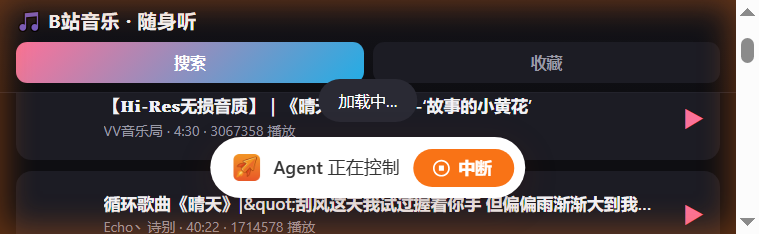
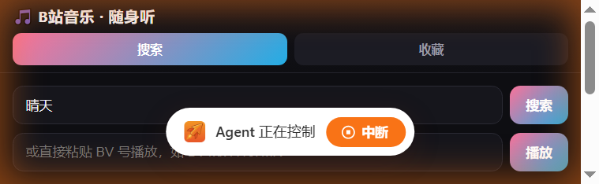

# Bili Music Web · 自托管 B 站音乐播放器

把 B 站当成一个私人音乐库：搜歌、听热门榜单、建收藏夹、看歌词，在手机浏览器里随身听。
**零依赖**——只用 Node 标准库，没有 `npm install`，一个 `node server.js` 就跑起来。

设计目标是跑在自托管设备（NAS / 小主机 / 家用服务器）上：音频由服务端代理并缓存，
手机端只跟你的服务器打交道，外出时用手机流量也能听。



---

## 特性

| | |
|---|---|
| **搜索 / 热门** | B 站搜索（含翻页）、全站热门榜单 |
| **收藏夹** | 多个收藏夹，增删改名，收藏数据存在服务端，跨设备共享 |
| **歌词** | 多源回退（腾讯 → 网易 → LRCLib），逐行高亮滚动 |
| **播放模式** | 顺序 / 列表循环 / 单曲循环 / 随机 |
| **断点续播** | 记住每首的播放位置与"最近播放"，换设备接着听 |
| **服务端音频缓存** | 听过的歌落盘复用，二次播放秒开，也省上行带宽 |
| **iOS 友好** | 服务端自动把 DASH 分片音频重混为标准 MP4（`faststart`），避免 iOS Safari 只能解析前 20 秒的问题 |
| **PWA** | 支持"添加到主屏幕"，锁屏控制（`Media Session`）正常 |
| **零依赖** | 只用 Node 标准库（≥18）；Docker 镜像已内置 ffmpeg |

移动端界面：

| 搜索 | 结果 | 桌面布局 |
|---|---|---|
|  |  |  |

---

## 环境要求

| 项 | 要求 | 说明 |
|---|---|---|
| Node.js | ≥ 18（用到全局 `fetch` / `AbortController`） | Docker 方式不需要本机安装 |
| ffmpeg | 可选，但**强烈建议** | 把 B 站 DASH 分片音频重混为标准 MP4（`-c copy -movflags +faststart`）。**缺了它 iPhone 上会出现「一首歌只播十几秒」，而且不会报任何错**。Docker 镜像已内置；Node 直跑时请确保 `ffmpeg` 在 PATH，或用 `FFMPEG_BIN` 指定路径 |
| 网络 | 服务端能访问 `bilibili.com` | 取流、搜索、歌词都由服务端发起，手机端只跟你的服务器通信 |

> **自检**：不管用哪种方式，先跑 `curl http://<地址>/api/health`，
> 返回 `{"ok":true,...}` 说明服务端已经正常工作；打不开就先看这一条，别急着查前端。

---

## 快速开始

### 方式一：Docker Compose（推荐）

```bash
git clone https://github.com/wx4766/bili-music-web.git
cd bili-music-web
docker compose up -d
curl http://localhost:8360/api/health     # 自检：应返回 {"ok":true,...}
```

打开 `http://<你的机器IP>:8360/`。收藏与缓存写在 `./data`（已挂载为卷）。

### 方式二：Node 直跑

```bash
node server.js
# 默认 http://localhost:3000
curl http://localhost:3000/api/health
```

注意：这种方式下 iOS 能否正常听完整首，取决于本机有没有 ffmpeg（见「环境要求」）。

### 方式三：飞牛 fnOS 应用包

`fpk/` 目录是飞牛 fnOS 的应用包工程，打出来的 `.fpk` 可直接在飞牛应用中心安装，
装好后走系统网关，地址形如 `https://<NAS>:5667/app/bilimusic/`（复用 NAS 登录态，无需额外口令）。

```bash
cd fpk
python build_fpk.py          # 需要 fnpack + Pillow
```

装好后打开 `https://<NAS>:5667/app/bilimusic/`，能看到热门列表即自检通过。

---

## 路线图

已完成的加固项与后续计划见 [docs/ROADMAP.md](docs/ROADMAP.md)：
多专家评审后收敛的 ≈40 条问题清单，按 P0 / P1 / P2 与三阶段排期。
第一波「止血与卫生」（跨实例写锁、日志脱敏、字体本地化、Docker 补 ffmpeg）已在 v1.1.0 完成。

---

## 配置

全部通过环境变量，不设即用默认值。

| 变量 | 默认 | 说明 |
|---|---|---|
| `PORT` | `3000` | HTTP 监听端口 |
| `DATA_DIR` | `./data` | 收藏夹、播放历史、音频缓存的存放目录 |
| `SOCKET_PATH` | 空 | 设置后改为监听 Unix Socket（配合反向代理，如 fnOS 网关） |
| `BASE_PATH` | 空 | 反向代理前缀，如 `/app/bilimusic`；根路径部署留空 |
| `ACCESS_TOKEN` | 空 | 设置后启用访问口令（见下）。**暴露到公网时强烈建议设置** |
| `FFMPEG_BIN` | `/usr/bin/ffmpeg` | 用于 iOS 音频重混；找不到 ffmpeg 时自动跳过重混 |

### 访问口令

服务本身没有账号体系。一旦把端口暴露到公网，任何人都可能拿它当"任意 BV 号的 B 站音频代理"，
还删得掉你的收藏夹。设一个口令即可：

```bash
ACCESS_TOKEN=你的口令 node server.js
```

之后首次用 `http://<地址>/?k=你的口令` 打开一次，浏览器会记住一年（写入 cookie），
以后直接访问根路径就行。`/api/health` 始终放行，方便探活。

### 在公网访问

> 前提是你有公网 IP（或 IPv6），并在路由器上做了端口映射。
> 家用宽带的上行通常远大于各种免费内网穿透中转，听歌体验差别很大。

1. 路由器把外部端口映射到本机（例如外部 `8360` → `192.168.1.x:3000`）。
   支持 UPnP 的路由器可以让服务端自动申请映射，省掉手动配置。
2. 用 DDNS 域名访问，例如 `http://nas.example.com:8360/`。
3. **务必设置 `ACCESS_TOKEN`**。
4. 想要 HTTPS / PWA 完整体验，在前面套一层反向代理（Caddy / nginx）签发证书。

---

## 已知限制

- **不登录 B 站**：走游客取流，听不了大会员专属的高码率 / Hi-Res 音源。
- **飞牛 App 内置浏览器不能出声**：飞牛手机 App 的 WebView 限制了音频播放，请用系统 Safari / Chrome 打开。
- **HTTP 下 PWA 无法离线**：Service Worker 需要安全上下文（HTTPS 或 localhost）。
- 音频缓存默认上限 200 个文件 / 1.5 GB，超出按 LRU 清理。

---

## 免责声明

本项目是个人自托管用途的技术实践，**不提供、不存储任何音频内容**——
所有音频都实时来自哔哩哔哩的公开接口，仅做转发与本地缓存。
请勿用于任何商业或侵权用途；B 站的相关权利归其运营方所有。
因使用本项目产生的任何后果由使用者自行承担。

---

## License

[MIT](LICENSE) © 2026 wx4766
